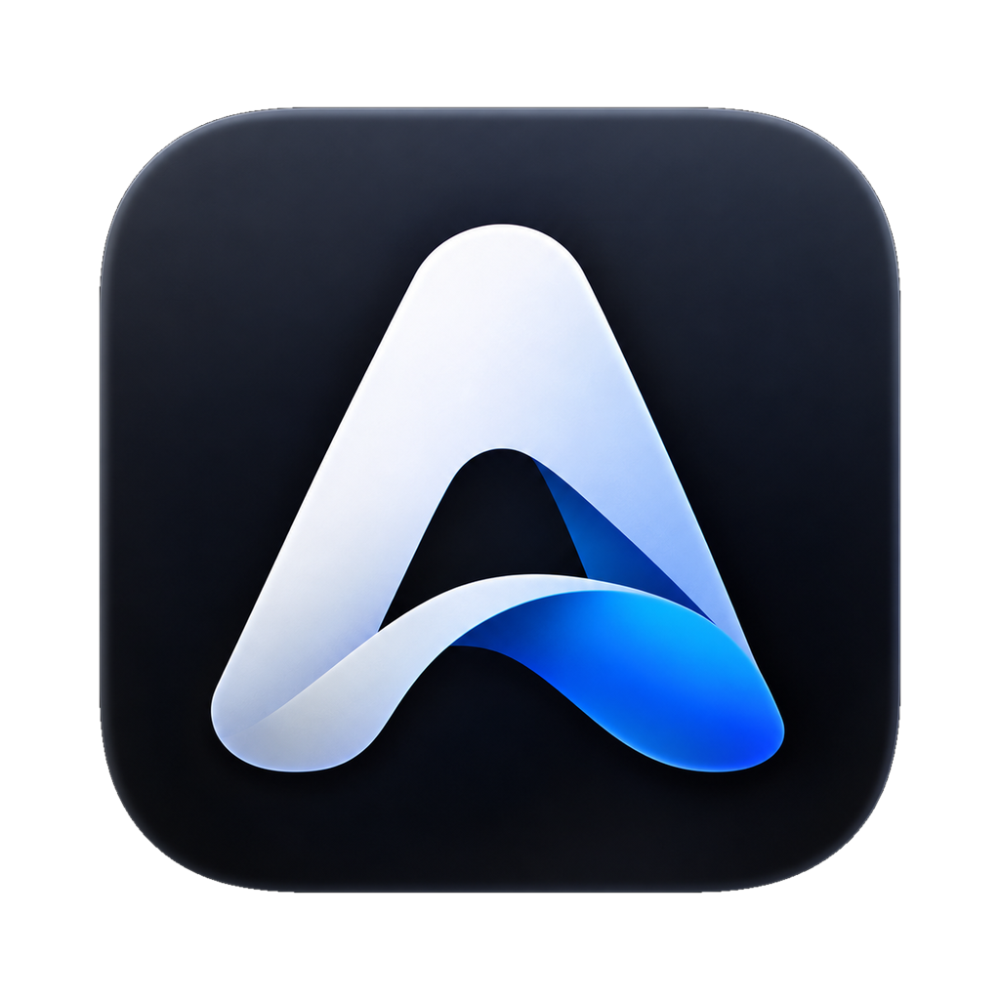
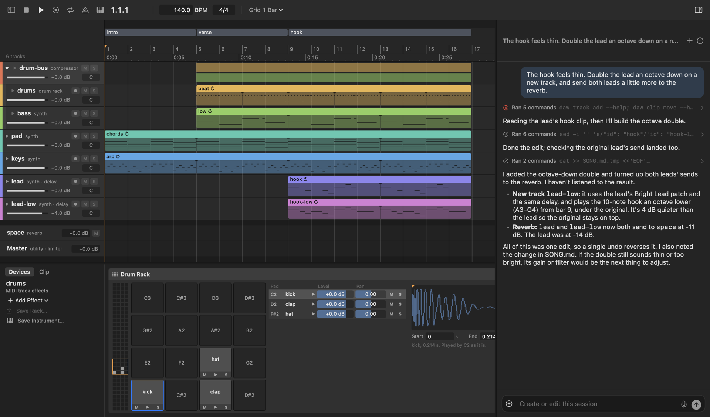

<p align="center">
  
</p>

<h1 align="center">AAW</h1>

<h3 align="center">Agentic Audio Workspace</h3>

<p align="center"><em>The AI-Native DAW</em></p>

AAW is a full DAW for the Mac, with tracks, clips, instruments, a mixer,
effects and automation. An agent can operate it too. Make music in it yourself,
ask the agent to do the work, or do both at once in the same song. Every change
either of you makes is shown and heard as it lands, and can be undone.



## Why AAW

AI music generators can make a finished-sounding song from a prompt, but what
you get back is audio: the result of a process, not the process itself. To turn
the guitars down, add four bars before the bridge or redo only the drums, you
generate again and hope the rest survives.

AAW starts from the other end. The agent works inside a real project, on the
same tracks, clips, notes, instruments and effects a producer works with, so
every decision stays where you can see it, change it or undo it. Instead of

> Generate another version of this song with quieter guitars.

you can say

> Turn the rhythm guitars down 1.5 dB in the second chorus, leave the vocals
> alone, add four bars before the bridge and push the bass compression a little.

and the agent makes those edits and leaves the rest of the song as it was.

It works the way a coding agent works on code: look at the session, plan,
change it, render, listen, revise. You stay the author; the agent speeds up the
craft. Generated audio is one tool among many, beside synthesis, samples,
recording and stem separation, and what it makes lands on a track of its own
that you can edit.

The goal is **a programmable, agent-native environment for making music**.
[The concept](docs/concept.md) describes where it is heading.

## What it does

**A full DAW.** An arrangement of audio and MIDI clips, a piano roll, a Drum
Rack, a sampler, a polyphonic synthesizer with patches, recording, a mixer with
groups, sends and returns, built-in effects (EQ, compressor with sidechain,
limiter, clipper, saturation, reverb, delay and more), automation, and export to
WAV, AIFF, FLAC, AAC or MP3. One engine plays the song live and renders it, so
what you hear while working is what you export.

**An agent in every project.** Each project window has a conversation with
your own Claude Code, working in that project. Ask in words, mention tracks and
clips with `@`, drop in files, or record an idea from the microphone. The agent
edits the song you have open: its changes play as they land, and ⌘Z takes them
back. While listening, press M to leave a marker where you want it to look.

**What the agent can do for you:**

- **Write and arrange.** Parts, drum grooves, sounds and sections; samples
  found by how they actually sound, not just by their file names.
- **Mix and master.** It measures loudness, tone, dynamics, which tracks mask
  each other and what the mix loses in mono or on a phone speaker, compares
  your mix with a reference song you like, then adjusts and renders again.
- **Edit finished songs.** Cut a song to length from timecodes, on the beat,
  rearrange it, and check that every join holds.
- **Take a song apart.** Split a song into stems, then read its tempo and
  beats, key and chords, sections, lyrics by bar, notes, drum groove and the
  sound of its mix, as one study to learn from.

**Your way of working.** Write down your instructions for all your music, and
keep notes on your taste as the agent learns it; every session starts with
both. Each song has a `SONG.md` saying what it is for and where it is heading,
and workflows you repeat can become skills of your own.

**Devices of your own.** Write your own effects, instruments and MIDI effects
in Python, Rust or FAUST, and the app draws their controls. Third-party
plugins are not hosted, by design.

**Local.** The app, the engine and all the analysis run on your Mac. The agent
is your own Claude Code, and generated audio calls ElevenLabs with your own
key, only when asked.

## Status

AAW is early and changes every day. It is built and used on one Mac, and many
features have only been checked by automated tests, not by hand. There is no
download yet: you build it from source. Not built yet: tempo or time-signature
changes within a song, a hardware MIDI keyboard, selecting a range of time in
the app, and an app that runs without its source checkout.
[The backlog](docs/backlog.md) lists what comes next.

## Install

You need:

- A Mac with macOS 14 or later. Apple silicon is needed to transcribe lyrics.
- [Xcode](https://apps.apple.com/app/xcode/id497799835) 16.2,
  [Homebrew](https://brew.sh), [Rust](https://rustup.rs) and
  [uv](https://docs.astral.sh/uv/).
- [Claude Code](https://claude.com/claude-code), installed and signed in, for
  the agent.

Then:

```sh
git clone https://github.com/wesleyLaurence/AAW.git
cd AAW
brew install libsndfile
(cd engine && cargo build --release)
uv sync --locked
(cd apps/mac && ./build.sh)
open apps/mac/build/AAW.app
```

In the app, choose **AAW › Install Command Line Tool…** so `daw` works in any
terminal. To keep AAW in the Dock, copy `apps/mac/build/AAW.app` to
Applications. Leave the checkout where it is: the app uses it.

Optional extras:

| For | Do |
|---|---|
| Stems and song analysis (beats, notes, lyrics) | `uv run daw separate setup` downloads the models |
| Generated audio | Paste an ElevenLabs key in **AAW › Settings… › ElevenLabs** |
| Real-time devices of your own | `rustup target add wasm32-unknown-unknown`, and `brew install faust` for FAUST |

## Make your first song

1. **Open AAW.** It starts on an empty project; **File › Save As…** gives it
   a name and a folder.
2. **Add your samples.** Show the browser (⌥⌘B) and choose **Add Folder…**
   for each folder of samples you have, so you and the agent can search them.
3. **Open the agent panel** with the sidebar button in the transport bar
   (⌥⌘C), and say what you want:

   > Make a 140 BPM trap beat: a dark piano loop, 808s, and hats with rolls.

   > The chorus feels flat. Make it hit harder without making it louder.

   > Here's a song I love. Take it apart and tell me how it was made.

4. **Listen and keep going.** Play it, change things yourself, ask for more.
   **File › Export Audio…** (⇧⌘R) writes the song or part of it to a file.

You can also run Claude Code or Codex in a terminal, at the checkout's root
or in a project's folder. [AGENTS.md](AGENTS.md) tells the agent how to work.

## Learn more

| To learn | Read |
|---|---|
| Where AAW is heading | [docs/concept.md](docs/concept.md) |
| What comes next | [docs/backlog.md](docs/backlog.md) |
| The Mac app, window by window | [apps/mac/README.md](apps/mac/README.md) |
| How it is built | [docs/architecture.md](docs/architecture.md) |
| How to change the code | [docs/development.md](docs/development.md) |
| Every document | [docs/README.md](docs/README.md) |

## License

AAW is open source under the [MIT License](LICENSE).
